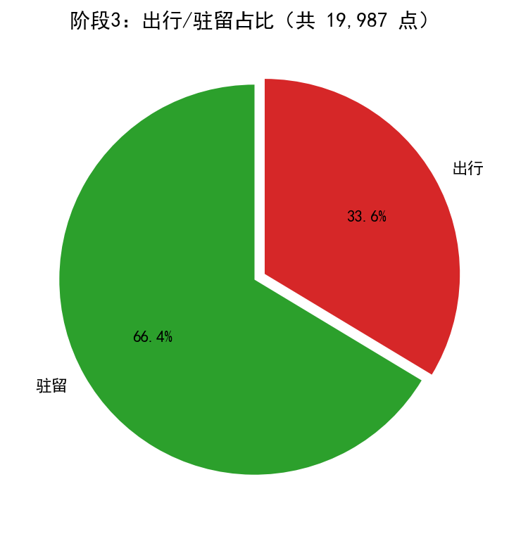
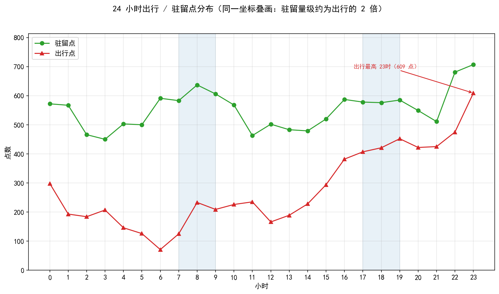
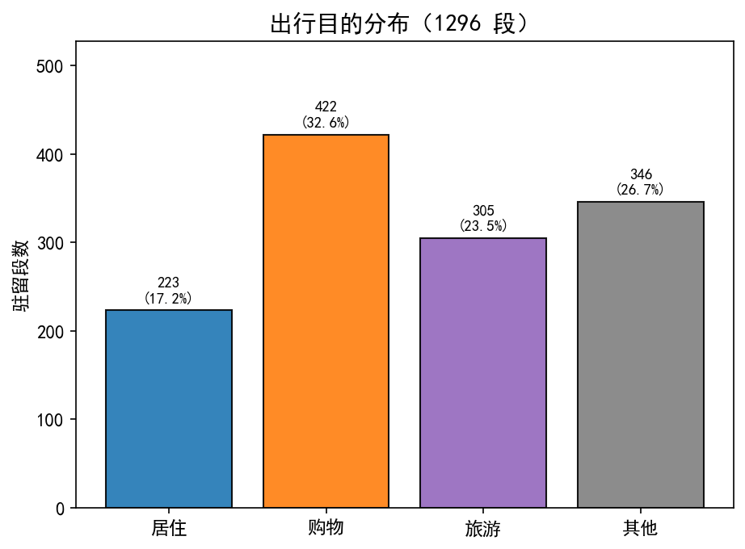
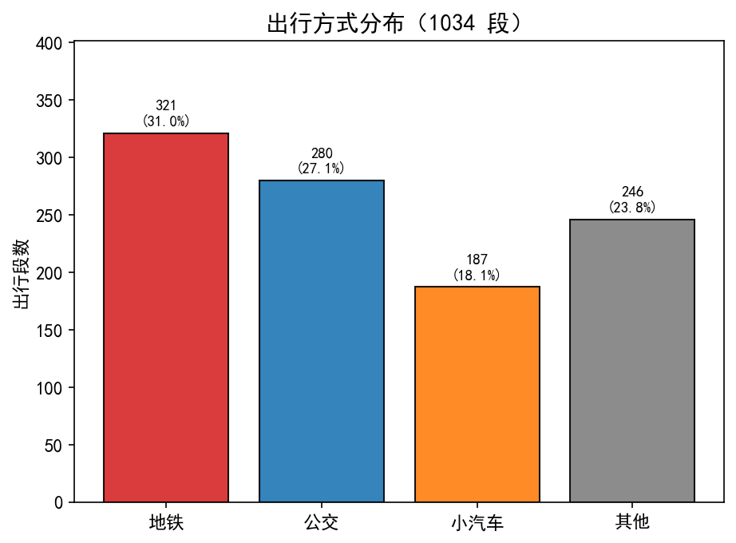
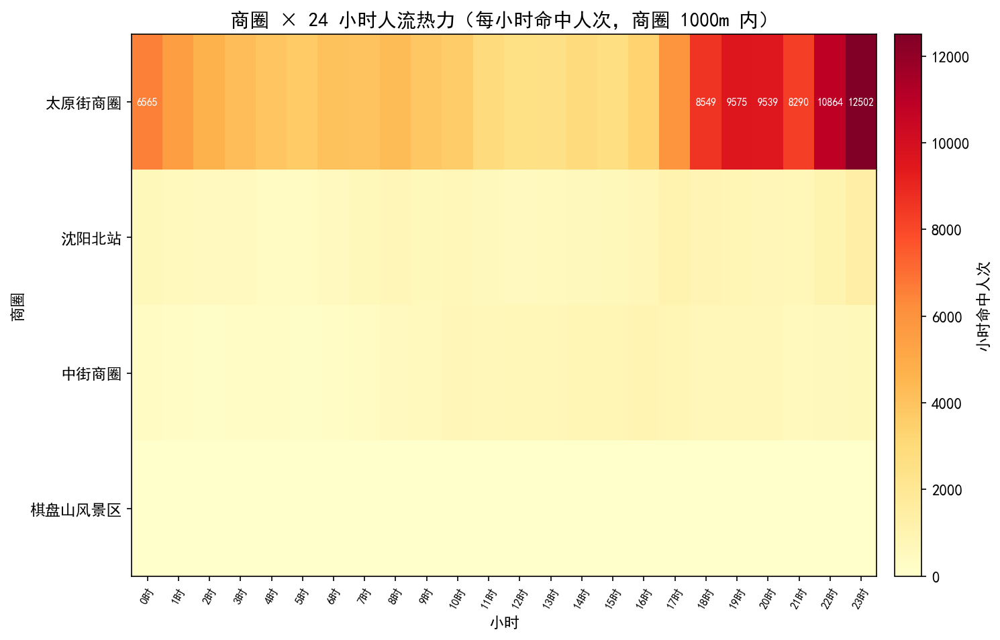
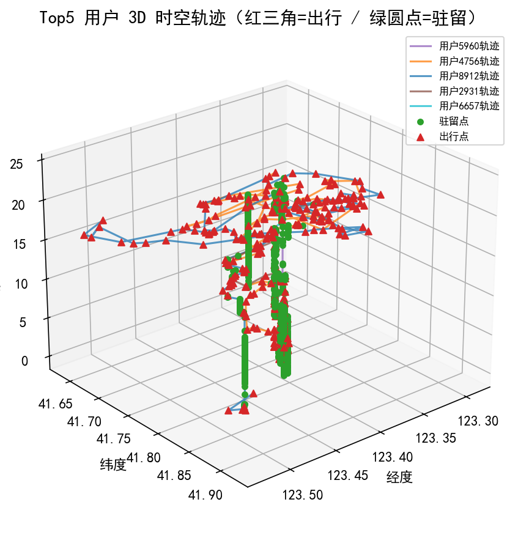

# 交通时空数据分析项目总结报告

生成时间：2026-10-16 08:16 ｜ 目标日期：20181003 ｜ 数据：沈阳运营商基站信令定位数据 ｜ 抽样口径：SAMPLE_ROWS = 20000（整用户抽样）

## 一、总体结论

- 清洗后得到 **19,987 个定位点 / 235 位用户 / 1563 个坐标**，时间范围 20181003000002 ~ 20181003235737；
- 阶段1 速度粗筛挑出 **7,163 个疑似出行点**（占清洗点 35.8%），相邻点速度中位 16.7 km/h；
- 阶段2 手写 K-Means 按用户聚类，得到 **1132 个簇**（475 个单点簇），最优 K 区间 2~10、均值 4.86；
- 阶段3 三点距离 + 首末跨度精判：**出行 6,723 点（33.6%）、驻留 13,264 点**，出行点来源 = 单点簇 475 + 多点簇 6248；
- 阶段4 出行目的：1296 个驻留段，POI 空间匹配率 92.8%；阶段5 出行方式：1034 个出行段；
- 实时热力：4,640 条非零 10 分钟窗口记录，峰值 2,570 人出现在 太原街商圈（2018-10-03 23:09:00）；
- 全部数字可由 `python main.py` 一次性重跑复现（同种子结果一致）。

## 二、工程结构与运行方式

```
config.py       全部路径与阈值（改参数只改这里，python config.py 自检输入文件）
utils.py        Haversine / pairwise 欧氏 / 计时器 / 中文字体 / 读写 / 日志
data_clean.py   ① 九条清洗规则 + 整用户抽样
tr_stage1.py    ② 阶段1：低频点标记（不删） + 连续段 + 速度粗筛（到达点与出发地同标）
tr_stage2.py    ③ 阶段2：手写 K-Means + 轮廓系数&邓恩指数选 K
tr_stage3.py    ④ 阶段3：三点距离 + 首末时间跨度规则精判
purpose.py      ⑤ 出行目的：POI 空间证据 + 时间窗兜底
mode.py         ⑥ 出行方式：站点邻近点数证据 + 速度兜底
heatmap.py      ⑦ 实时流 × 商圈 10 分钟滚动窗口热力
visualize.py    ⑧ 六张结果图
main.py         一键运行八模块（模块级容错 + 计时 + 产物核对）
tools/          可选工具：selfcheck.py 六项自检、report.py 本报告
```

```bash
python main.py                # 按 config.SAMPLE_ROWS 整用户抽样
python main.py --sample 0     # 全量约 53 万行
python main.py --no-fig       # 只出 CSV，不生成图
python data_clean.py          # 单独跑任一模块（每个模块都可独立执行）
python tools/selfcheck.py     # 交付前自检
python tools/report.py        # 重建本总结报告
```

依赖仅 `pandas + numpy + matplotlib`，**不使用 sklearn / geopandas**——K-Means、轮廓系数、邓恩指数、Haversine 全部按讲义手写实现。

## 三、① 数据清洗（9 条规则）

顺序：字段抽取 → 去脏 imsi → 去空基站编号 → 时间戳转换 → 目标日过滤 →（整用户抽样）→ 关联基站 → 排序 → 分钟去重 → 稀疏用户过滤。

原始时间戳是 13 位 **UTC 毫秒**，直接按 naive 解析会把北京时间整体前移 8 小时，「只保留 20181003」就变成了北京时间 10-03 08:00 ~ 10-04 08:00，凌晨记录全丢、还混进次日数据。规则4 因此先 `+8` 小时再做目标日过滤。

抽样单位用「整用户」而不是「整行」：随机抽行会把同一个人的连续轨迹抽碎，随后规则9（每人当天点数 ≥ 20）会把普通用户几乎全删光。

最终清洗产物：19,987 点 / 235 用户 / 1563 个坐标，六列 ['imsi', 'time', 'lac_id', 'cell_id', 'lon', 'lat']。

## 四、② 阶段1 连续段与速度粗筛

- 低频点（同用户同坐标出现 < 4 次）只打 is_low 标记、**不删行**（讲义口径是删除，本项目实测删除会连带删掉 83.7% 的高速移动点，见 README 七）；
- 相邻点速度 > 8.0 km/h 的到达点 5,399 个，再把每次移动的**出发地那一点**一并算作疑似出行（多 1,764 个），合计 7,163 个（占清洗点 35.8%）；出发地只是「刚离开」，同样不是驻留，误标与否交给阶段2/3 复核；
- 速度 <0 或 >200 km/h 视为基站跳跃，置 NaN 不参与判定（保留在表里供检查，不做删除）；
- 出行点速度中位 16.7 km/h、最大 199.5 km/h。

阶段1 是**高召回粗筛**：宁可多留点交给阶段2/3 精判，也不在这里下最终结论。

## 五、③ 阶段2 手写 K-Means 聚类

- 只对阶段1 的 7,163 个出行点、按用户分组聚类，共 233 位用户；
- 遍历 K=2~10，评分 `score = 轮廓系数 + 0.1 × 邓恩指数`；最优 K 最小 2、最大 10、平均 4.86；
- 得到 1132 个簇，其中 475 个单点簇——单点簇没有「跨度」可言，阶段3 直接补判为出行。

K-Means 内部用广播 `(n,1,2) - (1,k,2) → (n,k,2)` 一次算完所有距离；空簇保留上一轮中心，避免对空集取均值得到 NaN。距离矩阵在 K 循环外只算一次、各 K 复用；逐用户循环前先 `np.random.seed(42)` 一次，同参数重跑标签完全一致（见 `tools/selfcheck.py` 第 4 项）。

## 六、④ 阶段3 空间 + 时间双条件精判

判定规则：簇内**首/中/尾三点到簇心 Haversine 距离均 < 1000 m** 且 **簇内首末时间跨度 < 2 h** → 驻留(0)，否则出行(1)；单点簇直接判出行(1)；未进入聚类的点（阶段1 已判非出行）默认驻留(0)。

| 点来源          |    点数 |
| :--- | ---: |
| 单点簇直接判出行     |   475 |
| 多点簇不满足双条件判出行 |  6248 |
| 多点簇满足双条件判驻留  |   440 |
| 未参与聚类默认驻留    | 12824 |

最终：出行 6,723 点（33.6%）、驻留 13,264 点。

注意 label 方向：**1 = 出行、0 = 驻留**，且默认值是 0——「未参加聚类的点保守判驻留」，宁可少判出行也不把停留误判成赶路。阶段4 从 label==0 切驻留段，阶段5 从 label==1 切出行段。

## 七、⑤ 出行目的识别

规则链（窄条件在前，宽条件在后）：停留 > 4 h 且首末点落在夜间 [(0, 6), (20, 23)] → **居住**；否则若段中心到最近 POI < 1000 m 且该 POI 属于购物/旅游 → 取 POI 类型；再兜底 首末点都在 (9, 17) 内 → **旅游**，都在 (9, 21) 内 → **购物**，都不满足 → **其他**。

旅游窗 `[9,17]` 是购物窗 `[9,21]` 的子集，**如果把宽条件放前面，窄条件永远命不中，旅游会恒为 0**——这是课时 45 强调的「死代码陷阱」，`tools/selfcheck.py` 第 5 项专门对此做回归防护。

| 类别 |   段 |  占比% |
| :--- | ---: | ---: |
| 居住 | 223 | 17.2 |
| 购物 | 422 | 32.6 |
| 旅游 | 305 | 23.5 |
| 其他 | 346 | 26.7 |

合计 1,296 段。

共 1296 个驻留段，POI 空间匹配率 92.8%。

## 八、⑥ 出行方式识别

裁决优先级：**站点证据优先、速度兜底**。段内点到最近地铁站 < 500 m 的点数 ≥ 2 → 地铁；最近公交站邻近点数 ≥ 3 → 公交；均速 > 20 km/h → 小汽车；否则 → 其他。

地铁表只有 68 个站、公交表 900 个站，公交站密集容易误命中，所以公交的邻近点门槛（≥3）比地铁（≥2）更高。

| 类别  |   段 |  占比% |
| :--- | ---: | ---: |
| 地铁  | 321 | 31.0 |
| 公交  | 280 | 27.1 |
| 小汽车 | 187 | 18.1 |
| 其他  | 246 | 23.8 |

合计 1,034 段。

共 1034 个出行段（每段 ≥2 点才能算速度，单点段在建段阶段已丢弃）；段均速中位 20.8 km/h、段距离中位 2.14 km。

## 九、⑦ 实时商圈 10 分钟滚动窗口热力

实时流分批（每批 10000 行）广播匹配、命中阈值 1000 m；按分钟聚合后补齐成完整 1440 分钟再做 10 分钟滚动求和，输出 4,640 条非零窗口记录，涉及 4 个商圈。

补齐 1440 分钟是必须的：`rolling` 直接在稀疏时间索引上滑窗会跨空档累加，把几小时前的计数算进当前窗口。

窗口计数最高的商圈：

| 商圈     | 窗口内峰值人数 |
| :--- | ---: |
| 太原街商圈  |    2570 |
| 沈阳北站   |     287 |
| 中街商圈   |     215 |
| 棋盘山风景区 |      10 |

全天峰值 2,570 人（太原街商圈，2018-10-03 23:09:00）。

## 十、结果图（课时 56 六张）













出图纪律：类别顺序固定并 `reindex(fill_value=0)` 补齐，颜色与类别绑定，这样某一类计数为 0 时柱子不会错位、颜色也不会串味。

## 十一、交付产物清单

| 产物      | 文件                       | 大小        |
| :--- | :--- | :--- |
| 清洗数据    | cleaned_data.csv         | 1439.4 KB |
| 阶段1出行点  | stage1_travel_points.csv | 554.2 KB  |
| 阶段2聚类结果 | stage2_cluster.csv       | 582.2 KB  |
| 阶段3标签   | stage3_label.csv         | 1478.4 KB |
| 出行目的    | purpose_result.csv       | 162.6 KB  |
| 出行方式    | mode_result.csv          | 120.9 KB  |
| 实时热力    | heatmap_result.csv       | 176.7 KB  |
| 图 1     | fig_stage3_pie.png       | 35.8 KB   |
| 图 2     | fig_hour_line.png        | 111.9 KB  |
| 图 3     | fig_purpose_bar.png      | 34.5 KB   |
| 图 4     | fig_mode_bar.png         | 36.5 KB   |
| 图 5     | fig_heatmap.png          | 89.8 KB   |
| 图 6     | fig_3d_traj.png          | 173.0 KB  |

## 十二、局限与改进方向

1. **定位精度**：基站扇区定位误差数百米至数公里，1000 m 驻留半径与 1000 m POI 匹配阈值都受此上限约束，目的/方式结论只适合做趋势判断；
2. **采样密度**：信令是事件驱动上报，稀疏且不匀速，首末跨度 < 2 h 的阈值本质是对采样密度的妥协，可改用「首末时间差 / 点数」或按用户分位数自适应；
3. **选 K 指标**：轮廓系数 + 邓恩指数在簇密度差异大时偏保守，可加 SSE 肘部法或 Gap Statistic 做双指标交叉；
4. **类别不平衡**：静态 POI 表中居住类占比过半、地铁站数远少于公交站，最近邻匹配天然偏向多数类，兜底分支的排序因此不能随意交换；
5. **随机性**：K-Means 只在逐用户循环前固定一次全局种子，逐用户的最优 K 会受初始化顺序影响，与讲义参考数字有 ±3% 量级的小偏差；多次重启取 SSE 最小可进一步收敛；
6. **性能**：阶段2 逐用户 Python 循环、热力/匹配的分批广播是主要开销，可按用户 multiprocessing 分片，或先做网格预聚类再对质心跑 K-Means。
